<p align="center">
  
</p>

# pyturboquant-cpu

CPU implementation of **TurboQuant**, a data-oblivious vector quantization algorithm for compressing high-dimensional vectors with near-optimal distortion.

Based on the paper: [TurboQuant: Online Vector Quantization with Near-optimal Distortion Rate](https://arxiv.org/abs/2504.19874) (Zandieh et al., ICLR 2026).

## Installation

```bash
pip install pyturboquant-cpu
```

For development:

```bash
git clone https://github.com/pyturboquant/pyturboquant-cpu.git
cd pyturboquant-cpu
pip install -e ".[dev]"
```

## Quick Start

### MSE-Optimal Quantization

Minimizes mean-squared reconstruction error:

```python
import numpy as np
from pyturboquant_cpu import quantize_mse, dequantize_mse

# Random vectors (e.g., KV cache embeddings)
vectors = np.random.randn(100, 128)  # 100 vectors of dimension 128

# Quantize at 3 bits per coordinate
quantized = quantize_mse(vectors, bits=3, seed=42)

# Reconstruct
reconstructed = dequantize_mse(quantized)

# Check reconstruction quality
mse = np.mean(np.sum((vectors - reconstructed) ** 2, axis=1))
print(f"MSE: {mse:.4f}")
```

### Inner-Product-Optimal Quantization

Provides **unbiased** inner product estimates — essential for attention mechanisms and nearest-neighbor search:

```python
from pyturboquant_cpu import quantize_prod, dequantize_prod

# Quantize at 4 bits total (3 bits MSE + 1 bit QJL correction)
quantized = quantize_prod(vectors, bits=4, seed=42)
reconstructed = dequantize_prod(quantized)

# Inner products are unbiased: E[⟨y, x̃⟩] = ⟨y, x⟩
query = np.random.randn(128)
true_ip = vectors @ query
approx_ip = reconstructed @ query
print(f"Mean IP error: {np.mean(np.abs(true_ip - approx_ip)):.4f}")
```

## How It Works

TurboQuant is a **data-oblivious** algorithm — it requires no training data or calibration:

1. **Random Rotation**: Input vectors are multiplied by a random orthogonal matrix, transforming coordinates to follow a known Beta distribution
2. **Lloyd-Max Scalar Quantization**: Each coordinate is independently quantized using a precomputed optimal codebook for the Beta distribution
3. **QJL Residual Correction** (Prod mode only): A 1-bit Quantized Johnson-Lindenstrauss sketch of the residual removes inner-product bias

### Theoretical Distortion Bounds

For unit vectors on S^{d-1}:

| Bits | MSE Distortion | Inner Product Distortion |
|------|---------------|-------------------------|
| 1    | ≈ 0.36        | ≈ 1.57/d                |
| 2    | ≈ 0.117       | ≈ 0.56/d                |
| 3    | ≈ 0.03        | ≈ 0.18/d                |
| 4    | ≈ 0.009       | ≈ 0.047/d               |

These are within a factor of ~2.7× of the information-theoretic lower bound.

## API Reference

### `quantize_mse(vectors, bits, dim=None, seed=None)`

Quantize vectors using TurboQuant_MSE (MSE-optimal).

- **vectors**: array of shape `(..., d)` — input vectors
- **bits**: int in `[1, 8]` — bits per coordinate
- **seed**: int or None — random seed for reproducibility
- **Returns**: `QuantizedMSE` dataclass

### `dequantize_mse(quantized)`

Reconstruct vectors from MSE quantization result.

- **quantized**: `QuantizedMSE` — output of `quantize_mse`
- **Returns**: ndarray with same shape as original input

### `quantize_prod(vectors, bits, dim=None, seed=None)`

Quantize vectors using TurboQuant_Prod (unbiased inner products).

- **vectors**: array of shape `(..., d)` — input vectors
- **bits**: int in `[2, 8]` — total bits per coordinate
- **seed**: int or None — random seed
- **Returns**: `QuantizedProd` dataclass

### `dequantize_prod(quantized)`

Reconstruct vectors from Prod quantization result.

- **quantized**: `QuantizedProd` — output of `quantize_prod`
- **Returns**: ndarray with same shape as original input

## GPU Version

For GPU-accelerated quantization using PyTorch, see the companion package:

```bash
pip install pyturboquant-gpu
```

## Citation

```bibtex
@article{zandieh2025turboquant,
  title={TurboQuant: Online Vector Quantization with Near-optimal Distortion Rate},
  author={Zandieh, Amir and Daliri, Majid and Hadian, Majid and Mirrokni, Vahab},
  journal={arXiv preprint arXiv:2504.19874},
  year={2025}
}
```

## License

Apache 2.0
